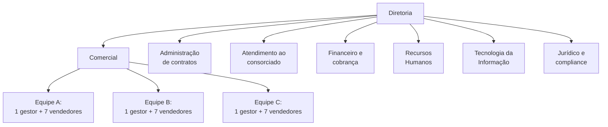
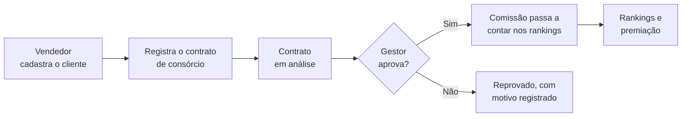
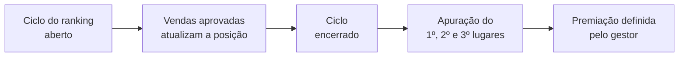

# Etapa 1 – Caracterização da Organização

## 1. Identificação da organização

A **Maelstrom** é uma empresa fictícia de pequeno porte, com 64 colaboradores, criada para a elaboração deste projeto. Atua no segmento de finanças, na administração e na venda de consórcios, e utiliza um modelo de gestão comercial baseado em metas, reconhecimento e transparência.

## 2. Ramo de atuação

A empresa atua no ramo de **contratos de consórcio**, no setor de serviços financeiros.

## 3. Missão, visão e valores

**Missão:** facilitar a conquista de bens e serviços por meio de consórcios acessíveis, transparentes e seguros, com atendimento próximo e humano. Unimos tecnologia e uma cultura de reconhecimento para valorizar as pessoas que constroem cada resultado.

**Visão:** ser reconhecida como uma administradora de consórcios ágil, transparente, movida por tecnologia e pelo engajamento de suas equipes.

**Valores:**

- **Transparência com o cliente:** informações claras sobre contratos, condições e prazos.
- **Ética e proteção dos dados:** tratamento responsável e seguro das informações de clientes e colaboradores.
- **Meritocracia:** reconhecimento proporcional ao desempenho, de forma justa e visível.
- **Colaboração:** trabalho conjunto entre as equipes e com os clientes.

## 4. Principais produtos ou serviços

A Maelstrom administra e vende **cotas de consórcio**. A venda dessas cotas é o principal fluxo de negócio da empresa e a atividade que sustenta sua receita. Cada venda gera um contrato, que passa pela análise e aprovação da empresa antes de ser considerado válido.

---

## 5. Estrutura organizacional

### 5.1 Organograma

### 5.2 Setores e quantidade de pessoas

| Setor | Pessoas | Função principal |
|---|---|---|
| Diretoria | 3 | Direção geral, estratégia e definição de metas |
| **Comercial** | **24** | 3 gestores e 21 vendedores, divididos em 3 equipes de vendas |
| Administração de contratos | 10 | Conferência documental e organização dos contratos |
| Atendimento ao consorciado | 8 | Suporte e relacionamento pós-venda |
| Financeiro e cobrança | 8 | Cobrança das parcelas e pagamento das comissões |
| Recursos humanos | 4 | Gestão de pessoas, metas e premiações |
| Tecnologia da informação | 5 | Infraestrutura, segurança e sistemas (inclui o administrador do sistema) |
| Jurídico e compliance | 2 | Conformidade regulatória e proteção de dados |
| **Total** | **64** | |

O setor **comercial** é o foco deste projeto, pois é nele que se aplica o sistema de ranking e comissões. Ele é dividido em **três equipes de oito pessoas**, cada uma com um gestor e sete vendedores.

### 5.3 Perfis de usuário do sistema

| Perfil | Quem é | O que pode fazer |
|---|---|---|
| **Administrador** | Integrante do setor de TI | Gerencia a plataforma e os usuários; abre e encerra o ranking geral |
| **Gestor** | Gestor de uma equipe comercial | Analisa e aprova ou reprova os contratos da equipe; administra o ranking interno e define os prêmios; acompanha os rankings das outras equipes |
| **Funcionário (vendedor)** | Vendedor de uma equipe comercial | Cadastra clientes; registra contratos de consórcio; acompanha sua posição nos rankings |

---

## 6. Principais processos de negócio

### 6.1 Fluxo principal de venda

### 6.2 Ciclo do ranking

### 6.3 Descrição dos processos

1. **Cadastro de clientes:** o vendedor registra os dados do cliente interessado em uma cota de consórcio.
2. **Venda do consórcio:** o vendedor formaliza a venda, gerando o contrato do cliente. O contrato é encaminhado para análise.
3. **Análise e aprovação:** o gestor da equipe avalia o contrato e o aprova ou reprova. Somente contratos aprovados são considerados vendas válidas. Quando o contrato é reprovado, o motivo da reprovação é registrado.
4. **Cálculo da comissão:** a cada venda aprovada, a comissão do vendedor é calculada e a sua pontuação é atualizada.
5. **Ranking:** existem dois tipos de ranking. O **ranking geral** reúne todos os vendedores de todas as equipes e é aberto e encerrado pela administração. Os **rankings internos** são de cada equipe e são administrados pelo respectivo gestor. Os gestores podem acompanhar os rankings das demais equipes.
6. **Premiação:** ao fim de cada ciclo, os três primeiros colocados (1º, 2º e 3º lugares) recebem as recompensas definidas pelo gestor.
7. **Registro e preservação do histórico:** as ações relevantes são registradas para fins de auditoria, e os registros são arquivados em vez de excluídos, preservando o histórico da operação.

---

## 7. Público-alvo

A solução atende a dois públicos:

- **Clientes:** pessoas que buscam adquirir bens e serviços de forma planejada por meio de consórcio.
- **Usuários internos:** os vendedores, que registram vendas e acompanham seu desempenho; os gestores, que analisam contratos e conduzem suas equipes; e a administração, que gerencia a operação.

## 8. Problemas identificados

Os processos tradicionais de acompanhamento de metas na área comercial geram três problemas principais:

1. **Falta de visibilidade** sobre o desempenho real das equipes em tempo real.
2. **Lentidão no cálculo e na apuração das comissões.**
3. **Baixo engajamento** da equipe comercial, que não enxerga com clareza como seu esforço se traduz em resultado e reconhecimento.

## 9. Justificativa da solução proposta

A solução proposta adota a **gamificação corporativa** como ferramenta de motivação e de automação gerencial. Um ranking automático, atualizado conforme as vendas aprovadas, torna o desempenho visível a todos e elimina o cálculo manual de comissões.

Como os vendedores acompanham sua posição e concorrem às recompensas do 1º ao 3º lugar, o ranking estimula o engajamento e a busca por melhores resultados. Os gestores, por sua vez, acompanham os rankings das outras equipes, o que os motiva a potencializar o desempenho da própria equipe. Assim, a solução melhora a transparência, agiliza a gestão e fortalece a motivação de toda a área comercial.
