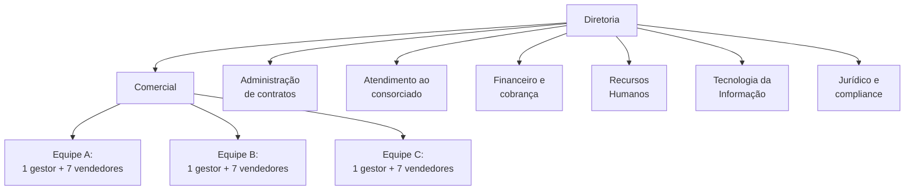
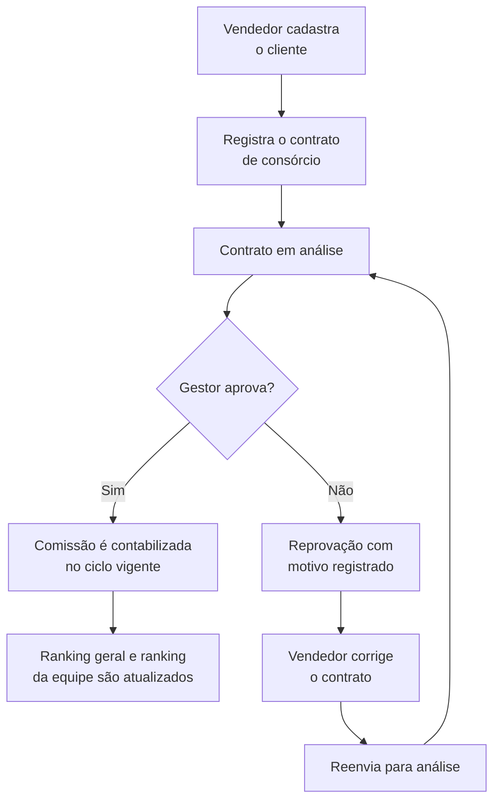
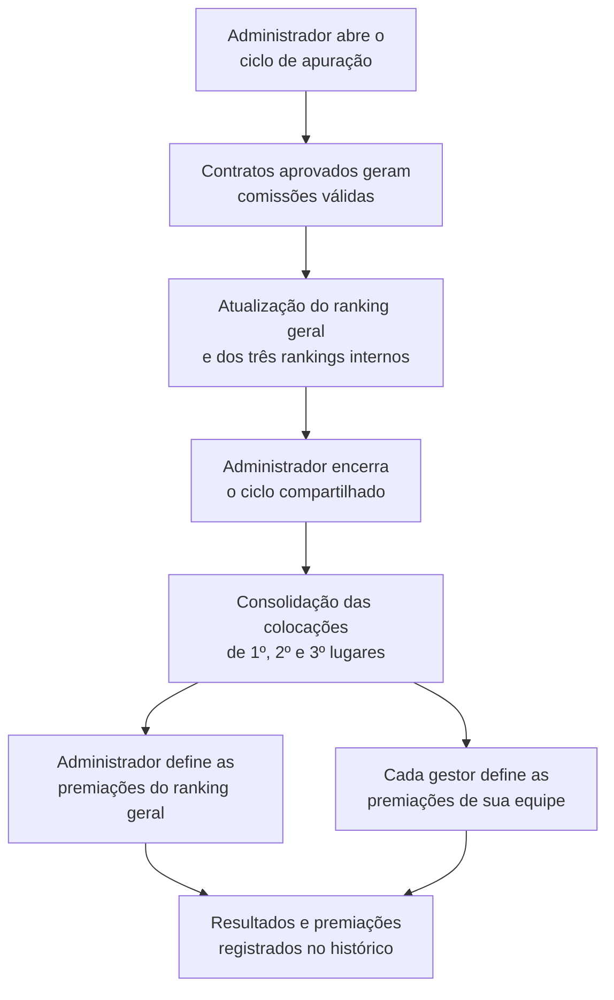

# Caracterização da Organização — DMcom Administradora de Consórcios

## 1. Identificação da organização

A **DMcom Administradora de Consórcios** é uma empresa fictícia de pequeno porte, com **64 colaboradores**, criada como cenário organizacional para o desenvolvimento do **ADMcom**, uma solução de apoio à gestão comercial. Atua no setor de serviços financeiros, com foco na administração e comercialização de consórcios, e adota uma cultura de gestão orientada por metas, transparência e reconhecimento de resultados.

## 2. Ramo de atuação

A DMcom atua no **segmento de consórcios**, oferecendo a comercialização e a administração de cotas para a aquisição planejada de bens e serviços. Sua operação envolve o relacionamento com interessados e consorciados, o registro e a análise de contratos e o acompanhamento administrativo e financeiro das operações.

## 3. Missão, visão e valores

**Missão:** facilitar a conquista de bens e serviços por meio de consórcios acessíveis, transparentes e seguros, com atendimento próximo e humano. Unimos tecnologia e uma cultura de reconhecimento para valorizar as pessoas que constroem cada resultado.

**Visão:** ser reconhecida como uma administradora de consórcios ágil, transparente, movida por tecnologia e pelo engajamento de suas equipes.

**Valores:**

- **Transparência com o cliente:** informações claras sobre contratos, condições e prazos.
- **Ética e proteção dos dados:** tratamento responsável e seguro das informações de clientes e colaboradores.
- **Meritocracia:** reconhecimento proporcional ao desempenho, de forma justa e visível.
- **Colaboração:** trabalho conjunto entre as equipes e com os clientes.

## 4. Principais produtos ou serviços

A DMcom administra e comercializa **cotas de consórcio**. A comercialização dessas cotas constitui o principal fluxo de negócio considerado neste projeto. Cada venda é formalizada por meio de um contrato, que passa por análise antes de ser reconhecido como aprovado. **Somente contratos aprovados** são considerados para o cálculo das comissões válidas e para a atualização dos rankings comerciais do ADMcom.

---

## 5. Estrutura organizacional

### 5.1 Organograma

### 5.2 Setores e quantidade de pessoas

| Setor | Pessoas | Função principal |
|---|---:|---|
| Diretoria | 3 | Direção geral, estratégia e definição de metas |
| **Comercial** | **24** | 3 gestores e 21 vendedores, divididos em 3 equipes de vendas |
| Administração de contratos | 10 | Conferência documental e organização dos contratos |
| Atendimento ao consorciado | 8 | Suporte e relacionamento pós-venda |
| Financeiro e cobrança | 8 | Cobrança das parcelas e pagamento das comissões |
| Recursos humanos | 4 | Gestão de pessoas, metas e apoio às iniciativas de reconhecimento |
| Tecnologia da informação | 5 | Infraestrutura, segurança e sistemas (inclui o administrador do ADMcom) |
| Jurídico e compliance | 2 | Conformidade regulatória e proteção de dados |
| **Total** | **64** | |

O setor **comercial** é o foco do ADMcom. Está dividido em **três equipes de oito pessoas**, cada uma formada por **um gestor e sete vendedores**. Assim, há **21 vendedores** participantes dos rankings e **três gestores** responsáveis pelo acompanhamento de suas respectivas equipes.

### 5.3 Perfis de usuário do sistema

| Perfil | Quem é | Principais responsabilidades no ADMcom |
|---|---|---|
| **Administrador** | Integrante do setor de TI | Gerencia a plataforma e os usuários; abre e encerra o ciclo de apuração compartilhado pelos rankings geral e internos; define as premiações do ranking geral. |
| **Gestor** | Gestor de uma equipe comercial | Analisa, aprova ou reprova os contratos de sua equipe; acompanha os rankings geral e internos; define as premiações dos três primeiros colocados no ranking da própria equipe. |
| **Funcionário (vendedor)** | Vendedor de uma equipe comercial | Cadastra clientes; registra contratos de consórcio; corrige e reenvia contratos reprovados; acompanha sua classificação nos rankings. |

---

## 6. Principais processos de negócio

### 6.1 Fluxo principal de venda e aprovação

O registro de um contrato, isoladamente, **não gera pontuação no ranking**. A comissão é contabilizada para fins de classificação somente depois da aprovação pelo gestor. Em caso de reprovação, o motivo é registrado, e o vendedor pode corrigir e reenviar o contrato para nova análise.

### 6.2 Ciclo dos rankings e premiações

O ADMcom apresenta **quatro classificações**, vinculadas a **um único ciclo de apuração**:

- **Ranking geral:** reúne os 21 vendedores das equipes A, B e C.
- **Ranking interno da equipe A:** considera os sete vendedores da equipe A.
- **Ranking interno da equipe B:** considera os sete vendedores da equipe B.
- **Ranking interno da equipe C:** considera os sete vendedores da equipe C.

Todos os rankings ordenam os vendedores conforme o **total de comissões válidas no ciclo**, em ordem decrescente. A aprovação de um contrato atualiza automaticamente a posição do vendedor nos rankings aplicáveis. Ao encerrar o ciclo compartilhado, o administrador consolida os resultados dos quatro rankings.

**Cada ranking possui premiação própria para os três primeiros colocados.** O **administrador** define as premiações do ranking geral, enquanto **cada gestor** define as premiações dos três primeiros colocados de sua equipe.

### 6.3 Descrição dos processos

1. **Cadastro de clientes:** o vendedor registra os dados do cliente interessado em uma cota de consórcio.
2. **Registro de contrato:** o vendedor formaliza a venda e vincula o contrato ao cliente cadastrado, encaminhando-o para análise.
3. **Análise e aprovação:** o gestor responsável avalia o contrato e decide pela aprovação ou reprovação. Em caso de reprovação, registra o motivo para permitir a correção e o reenvio pelo vendedor.
4. **Cálculo de comissão:** após a aprovação, o sistema calcula e contabiliza a comissão válida associada ao contrato para fins de apuração comercial.
5. **Atualização dos rankings:** as comissões aprovadas atualizam automaticamente o ranking geral e o ranking interno da equipe correspondente, durante o ciclo aberto.
6. **Encerramento do ciclo:** o administrador encerra o ciclo compartilhado, consolidando a classificação final dos quatro rankings.
7. **Definição das premiações:** o administrador define os prêmios do ranking geral, e os gestores definem os prêmios dos rankings de suas respectivas equipes, contemplando o 1º, 2º e 3º lugares em cada classificação.
8. **Registro e preservação do histórico:** contratos, decisões e resultados relevantes são mantidos para consulta e rastreabilidade. A operação prioriza o arquivamento de registros em vez de sua exclusão definitiva.

---

## 7. Público-alvo

A atuação da **DMcom** e a utilização do **ADMcom** envolvem públicos distintos:

- **Clientes e consorciados da DMcom:** pessoas interessadas em adquirir bens e serviços de maneira planejada por meio de consórcios. Seus dados e contratos integram o processo comercial, mas eles **não são usuários diretos** do ADMcom nesta proposta.
- **Usuários internos do ADMcom:** vendedores, gestores comerciais e administradores, que utilizam o sistema de acordo com suas responsabilidades e permissões.

A solução é direcionada principalmente às necessidades operacionais e gerenciais do setor comercial.

## 8. Problemas identificados

O acompanhamento comercial baseado em controles predominantemente manuais apresenta três problemas principais:

1. **Falta de visibilidade:** vendedores e gestores não dispõem de uma visão atualizada e integrada do desempenho individual e das equipes.
2. **Lentidão no cálculo e na apuração das comissões:** a consolidação manual dos contratos aprovados exige tempo e pode dificultar a conferência dos resultados.
3. **Baixo engajamento:** a ausência de acompanhamento contínuo e de reconhecimento visível dificulta a percepção dos resultados alcançados pelos vendedores.

## 9. Justificativa da solução proposta

O **ADMcom** é proposto como uma solução de **transformação digital** voltada à gestão comercial da DMcom. O sistema reúne o registro de contratos, o acompanhamento da aprovação, o cálculo automatizado das comissões válidas e a atualização dos rankings, reduzindo a dependência de controles manuais.

Por meio da **gamificação corporativa**, o ADMcom disponibiliza classificações atualizadas por equipe e em nível geral, destacando os três primeiros colocados de cada ranking. As premiações associadas às classificações incentivam o acompanhamento de metas e oferecem formas de reconhecimento do desempenho comercial.

Além de ampliar a visibilidade dos resultados para os vendedores, a solução oferece aos gestores informações mais organizadas para acompanhar suas equipes e ao administrador instrumentos para controlar os ciclos de apuração. Dessa forma, pretende contribuir para maior transparência, agilidade operacional e engajamento da área comercial.

## 10. Contexto tecnológico atual

Antes da implantação do ADMcom, a DMcom utiliza **procedimentos predominantemente manuais** para acompanhar as vendas, conferir os contratos aprovados, calcular comissões e consolidar classificações de desempenho. As informações precisam ser reunidas periodicamente pelos setores responsáveis, e os resultados são comunicados às equipes após a apuração.

Esse modelo dificulta o acompanhamento imediato das posições dos vendedores e aumenta o esforço necessário para consolidar dados de diferentes equipes. A ausência de uma ferramenta integrada para o processo comercial torna a apuração mais lenta e limita a visibilidade dos resultados ao longo do ciclo.

Nesse cenário, a implantação do **ADMcom** representa a passagem de controles comerciais manuais para um processo digital integrado: o vendedor registra o contrato, o gestor realiza a análise, e as aprovações alimentam automaticamente o cálculo das comissões e os rankings geral e internos. O administrador acompanha a operação dos ciclos, e os responsáveis registram as premiações ao término de cada período.

O escopo da transformação digital concentra-se **na gestão de contratos comerciais, comissões, rankings e premiações**, não na substituição de todos os sistemas administrativos ou financeiros utilizados pela organização.
