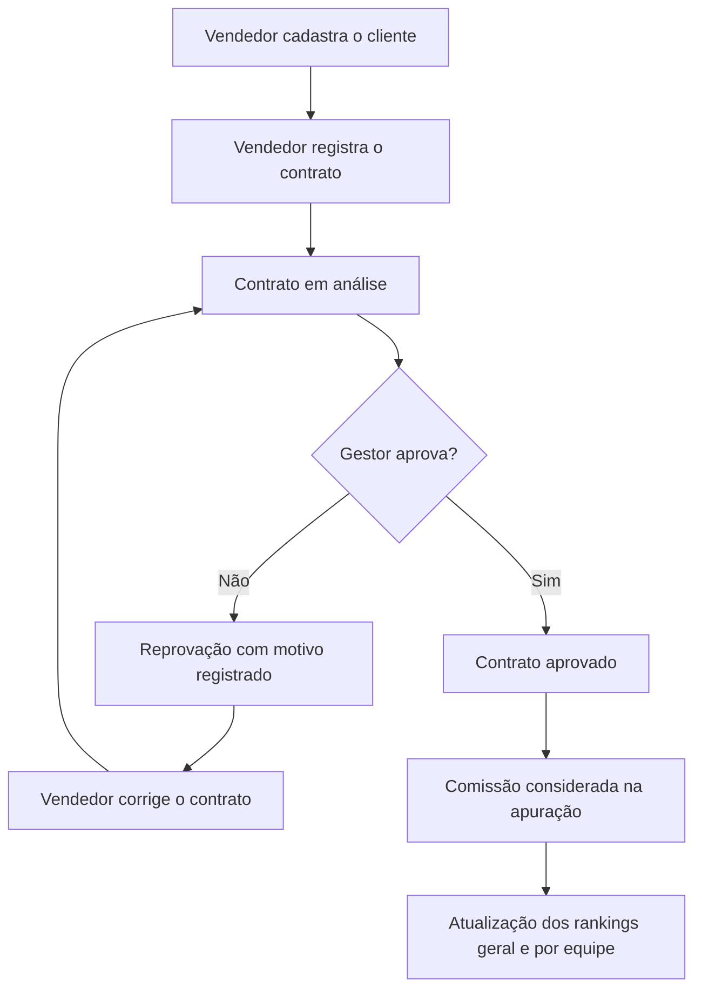

<div align="center">

# ADMcom

### Gestão Comercial, Comissões e Gamificação

**Uma proposta de transformação digital para a DMcom Administradora de Consórcios**


</div>

> **Nota:** ADMcom é o nome utilizado atualmente para identificar o sistema e ainda está sujeito à validação da equipe. A política de cálculo das comissões também está em definição.

## Visão geral

O **ADMcom** é um projeto de sistema de gestão comercial voltado à **DMcom Administradora de Consórcios**, empresa fictícia com **64 colaboradores**. Seu propósito é apoiar a digitalização de processos da área comercial, reunindo o registro e a análise de contratos, a apuração de comissões e o acompanhamento do desempenho das equipes.

A proposta utiliza **gamificação**, por meio de rankings e premiações, para tornar os resultados mais visíveis e incentivar o reconhecimento dos vendedores. O projeto encontra-se **em desenvolvimento**: as funcionalidades descritas a seguir representam o escopo proposto, e não necessariamente recursos já finalizados.

## Contexto da organização

A **DMcom** atua na administração e comercialização de cotas de consórcio. Sua estrutura inclui três equipes comerciais, cada uma composta por **um gestor e sete vendedores** — totalizando **21 vendedores**.

No cenário fictício definido para o projeto, o acompanhamento comercial e a consolidação dos resultados ainda dependem de **controles predominantemente manuais**. Isso dificulta a consulta rápida às informações e aumenta o esforço de apuração das comissões e das classificações.

A estrutura organizacional, os processos de negócio e o contexto da empresa estão detalhados na [caracterização da DMcom](Docs/01-Empresa/caracteriza%C3%A7%C3%A3o.md).

## Problemas e solução proposta

| Desafio identificado | Como o ADMcom pretende contribuir |
|---|---|
| Apuração manual e demorada das comissões | Automatizar o cálculo e a consolidação das comissões de contratos aprovados, conforme as regras de negócio a serem definidas |
| Dificuldade de acompanhar contratos | Centralizar o registro, a análise e a situação de cada contrato |
| Visibilidade limitada do desempenho comercial | Disponibilizar rankings por equipe e um ranking geral, atualizados com base nas vendas aprovadas |
| Baixo engajamento e reconhecimento pouco visível | Apoiar ciclos de competição e premiação para os três primeiros colocados de cada ranking |

## Funcionalidades previstas

- **Acesso por perfil:** administrador, gestor e funcionário (vendedor).
- **Cadastro de clientes:** registro e consulta das informações necessárias à operação comercial.
- **Registro de contratos:** vinculação de contratos aos clientes e encaminhamento para análise.
- **Análise de contratos:** aprovação ou reprovação pelo gestor, com indicação do motivo da reprovação e possibilidade de correção e reenvio.
- **Comissões:** apuração de valores associados aos contratos aprovados, conforme critérios a serem definidos pelo grupo.
- **Ranking geral:** classificação dos vendedores das três equipes.
- **Rankings por equipe:** classificação dos sete vendedores de cada equipe comercial.
- **Ciclos e premiações:** período de apuração compartilhado entre os rankings, com premiação dos três primeiros colocados de cada classificação.
- **Histórico e rastreabilidade:** preservação das informações relevantes dos processos comerciais.

> **Importante:** a definição dos percentuais e critérios de comissão ainda será discutida pela equipe. A lista representa o planejamento do produto e será refinada junto aos requisitos e ao Product Backlog.

## Como funciona o fluxo comercial



**Regras operacionais já definidas para a proposta:**

- Apenas contratos **aprovados** contribuem para a apuração de comissões e a classificação nos rankings.
- O **administrador** controla a abertura e o encerramento do **ciclo compartilhado** dos rankings.
- O **administrador** define a premiação do ranking geral.
- Cada **gestor** define a premiação do ranking da própria equipe.
- O ranking geral e os três rankings das equipes possuem **classificações e premiações próprias**, mesmo compartilhando o período de apuração.

## Tecnologias e ferramentas

| Categoria | Tecnologia ou ferramenta | Finalidade no projeto |
|---|---|---|
| Programação | **C** | Implementação do protótipo e das rotinas principais |
| Persistência | **SQLite** | Armazenamento local dos dados |
| Ambiente de desenvolvimento | **Code::Blocks** | Edição, compilação e execução do protótipo |
| Diagramas | **Draw.io** | Fluxogramas e modelagem visual |
| Modelagem UML | **Astah** | Diagramas de análise e projeto |
| Versionamento e colaboração | **Git e GitHub** | Controle de versões e integração das contribuições |

## Estrutura do repositório

O repositório está organizado por tipo de material, separando a implementação, os diagramas e a documentação do produto. A tabela abaixo funciona como um ponto de acesso às áreas principais.

| Diretório ou arquivo | Conteúdo | Acesso |
|---|---|---|
| `Código_em_C/` | Código-fonte do protótipo, rotinas em C e integração com o banco de dados. | [Ver código-fonte](Código_em_C/) |
| `Diagramas/` | Fluxogramas, modelos de dados e diagramas de análise do sistema. | [Ver diagramas](Diagramas/) |
| `Docs/` | Documentação técnica da empresa, do produto e do processo de desenvolvimento. | [Ver documentos](Docs/) |
| `README.md` | Apresentação geral e ponto de entrada do repositório. | Você está aqui |

## Documentação técnica

A pasta [`Docs/`](Docs/) concentra os arquivos Markdown que registram **o contexto da organização, as decisões do produto e a evolução do desenvolvimento**. O conteúdo acadêmico separado por disciplina é mantido fora deste repositório.

### Organização dos documentos

| Área | Arquivo ou pasta de referência | O que documenta | Situação |
|---|---|---|---|
| **01 · Empresa** | [Caracterização da DMcom](Docs/01-Empresa/caracteriza%C3%A7%C3%A3o.md) | Identificação, missão, estrutura, processos comerciais e cenário anterior à digitalização. | Em revisão pelo grupo |
| **02 · Requisitos** | `Docs/02-Requisitos/requisitos.md` | Requisitos funcionais, não funcionais e regras de negócio em **um único Markdown**. | Organização planejada |
| **03 · Produto** | `Docs/03-Produto/` | Histórias de usuário e Product Backlog, com necessidades e prioridades do sistema. | Organização planejada |
| **04 · Sprints** | `Docs/04-Sprints/` | Histórico de cada Sprint: objetivo, planejamento, tarefas, entregas, impedimentos e retrospectiva. | Organização planejada |
| **05 · Atas** | `Docs/05-Atas/` | Registro de reuniões, decisões do grupo, responsáveis e pendências. | Organização planejada |

> **Nota sobre os links:** as áreas marcadas como *organização planejada* indicam a estrutura proposta para os próximos documentos. Seus caminhos ainda não são links de navegação, para evitar apontar para arquivos ou pastas que o grupo não criou ou confirmou. À medida que a equipe organizar as pastas, esta tabela poderá receber os links correspondentes.

### Como consultar a documentação

A **caracterização** explica a empresa e o problema que motivou o sistema; os **requisitos** definem o comportamento esperado e as restrições; a área de **produto** reúne as necessidades priorizadas; os arquivos de **Sprints** registram a execução; e as **atas** preservam as principais decisões coletivas.

Isso permite acompanhar o projeto sem misturar documentação do produto com o conteúdo acadêmico preparado para a avaliação do curso.

## Execução do protótipo

**O código principal ainda está em desenvolvimento e integração.** As instruções completas de compilação, configuração do SQLite e execução do sistema serão acrescentadas quando houver um fluxo de execução único e validado.

Para obter o repositório localmente:

```bash
git clone https://github.com/KauanRodolfo/Pim-2-ADS.git
cd Pim-2-ADS
```

Os arquivos de implementação disponíveis podem ser consultados na pasta [`Código_em_C/`](Código_em_C/). A presença de módulos ou projetos individuais não significa que todas as funcionalidades já estejam integradas.

## Organização do desenvolvimento

A equipe utiliza práticas do **Scrum** para planejar entregas incrementais, com apoio de um **quadro Kanban no GitHub Projects** para visualizar e acompanhar as atividades.

Os **registros de execução de cada Sprint** serão documentados em `Docs/04-Sprints/`, enquanto as **decisões tomadas em reuniões** serão registradas em `Docs/05-Atas/`, conforme essas áreas forem organizadas. As histórias de usuário e o Product Backlog ficarão em `Docs/03-Produto/`. O quadro Kanban continuará servindo para acompanhar o estado das atividades; os Markdown preservarão o contexto e o histórico das entregas.

## Equipe

| Integrante | Responsabilidade |
|---|---|
| Victor de Souza Pascoaleto | Product Owner |
| Kauan Rodolfo Machado Silva | Scrum Master |
| Arthur Assis | Desenvolvedor |
| Chayon Sunshine Silva e Priante | Desenvolvedor |
| Elton Henrique da Silva | Desenvolvedor |
| William Ramos Cintra | Desenvolvedor |

## Colaboração e controle de versões

O desenvolvimento é realizado em equipe, com uso de branches individuais e integração das alterações à `main` mediante alinhamento entre os integrantes. O GitHub é utilizado para preservar o histórico de evolução do projeto e apoiar a revisão das contribuições.

---

<div align="center">

**DMcom Administradora de Consórcios · Projeto ADMcom**

*Desenvolvido por estudantes de Análise e Desenvolvimento de Sistemas da Universidade Paulista (UNIP).*

</div>


